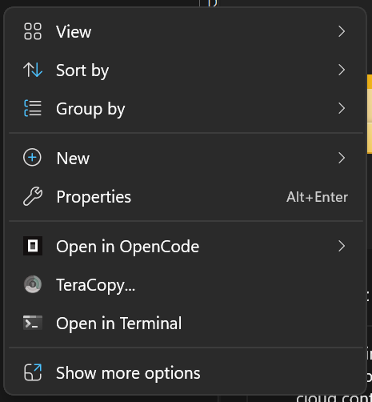

<div align="center">

# Open in OpenCode

**Right-click any folder in Windows and start [OpenCode](https://opencode.ai) right there.**
<br>The same gesture as *Open in Terminal*, for the opencode CLI.

[](https://github.com/hemil2005/open-in-opencode/releases)
[](LICENSE)
[](#compatibility)
[](#compatibility)

[Install](#install) | [Usage](#usage) | [Configuration](#configuration) | [Troubleshooting](#troubleshooting) | [Development](docs/development.md)

<br>



</div>

> **Unofficial project.** Open in OpenCode is independent. It is not made by, endorsed by, or affiliated with the OpenCode team. "OpenCode" is used only to name the tool this extension launches.

## Why

Opening a folder in OpenCode normally means opening a terminal, `cd`-ing to the folder, and typing `opencode`. This adds a top-level entry to the Windows 11 context menu that does all three in one click, with shortcuts for resuming your last session.

## Install

### One command

```powershell
irm https://github.com/hemil2005/open-in-opencode/releases/latest/download/install.ps1 | iex
```

The script asks for administrator rights once, checks the Windows build, and installs the
supported path: the MSIX package on Windows 11, or the classic-menu installer on Windows 10.
Running it again upgrades in place.

### Package managers

```powershell
winget install OpenInOpenCode.OpenInOpenCode
scoop install open-in-opencode
```

The manifests live under `manifests/`; they become installable once the first release is
tagged and the winget/scoop entries are accepted.

### From the installer

1. Download **`OpenInOpenCodeSetup-<version>.exe`** from the [latest release](https://github.com/hemil2005/open-in-opencode/releases/latest).
2. SmartScreen will say "unknown publisher", because the package is signed with a self-signed certificate. Choose **More info**, then **Run anyway**.
3. Approve the UAC prompt.
4. Right-click any folder, or empty space inside one.

You need [opencode](https://opencode.ai) installed and signed in. Developer Mode is **not** required.

<details>
<summary><strong>What does the installer actually do? Is it safe?</strong></summary>

<br>

- On Windows 11 it trusts the signing certificate in `LocalMachine\TrustedPeople` (not the Root store) and installs the MSIX package. On Windows 10 it places `ocshell.exe` in `Program Files` and registers classic context-menu verbs.
- The extension only launches a local process. There is no telemetry, no elevation, and no network access beyond update checks.
- Uninstalling from **Settings > Apps** removes the package and offers to remove the certificate too.
- Everything is open source. You can [build and sign it yourself](docs/development.md).

</details>

## Usage

Right-click a folder, or empty space inside one, and choose **Open in OpenCode**:

| Entry | What it runs |
|---|---|
| **New session** | `opencode "<folder>"` |
| **Continue last session** | `opencode --continue "<folder>"`. Starts a new session if the folder has no history. |
| **Skip permission prompts** | `opencode --auto "<folder>"`. Auto-approves permissions that aren't explicitly denied, so use it only in folders you trust. |

**Where it appears:** folder icons and empty space inside a folder. On Windows 10 it also covers drive icons and the desktop background through classic verbs.

**Good to know**

- Select more than one item and the entry is hidden, since only one folder can be used.
- If `opencode` can't be found, you get a warning dialog and details in the log.
- The terminal window closes when opencode exits.

## Features

- **Top-level entry** in the Windows 11 menu, not buried under *Show more options*.
- **Smart "continue"** that falls back to a new session when a folder has no history.
- **Finds opencode for you** across npm, curl, scoop, chocolatey and `PATH` installs.
- **Finds your terminal**: Windows Terminal, Alacritty, WezTerm, kitty, Ghostty, ConEmu, mintty and others, with the Windows console as fallback.
- **Crash-safe**: runs out of process, so a fault can't take down Explorer.
- **Signed package** with standard MSIX auto-updates.
- **Optional opencode plugin** that adds a `/ocshell` command to the TUI.

## Compatibility

| | Menu style | Status |
|---|---|---|
| Windows 11 (build 22000+) | Modern menu, top level | Tested |
| Windows 10 (1809+) | Classic menu via registry verbs | Not yet tested on real Windows 10 hardware |
| x64 | | Supported |
| arm64 | | Builds, and the packaged COM class activates on a Windows on ARM CI runner |

## Configuration

Settings live in `%APPDATA%\OpenInOpenCode\settings.json` and are managed with `ocshell.exe`:

```powershell
ocshell doctor                  # check package, certificate, binary and terminal
ocshell settings list
ocshell settings terminals      # what was discovered, and where
ocshell settings set terminal.id alacritty
ocshell settings locate-binary  # file picker for opencode.exe
ocshell selftest
```

<details>
<summary><strong>All settings</strong></summary>

<br>

| Key | Values |
|---|---|
| `binaryPath` | Full path to `opencode.exe`. Empty means auto-discovery. Also overridable with `OPENCODE_SHELL_BINARY`. |
| `terminal.mode` | `auto`, `default` (no terminal wrapper) or `custom` |
| `terminal.id` | A terminal id from `settings terminals` (used in `auto` mode) |
| `terminal.customPath` | Executable for `custom` mode |
| `terminal.customArgs` | Argument template, e.g. `--working-directory {dir} -e {command}` |
| `continueFromProjectRoot` | `true` / `false`. Fall back to the project root session. |
| `logging` | `true` / `false`. Verbose log lines. |

Argument templates understand `{dir}`, `{command}`, `{commandline}` and `{pscommand}`. A terminal discovered without a known command template is marked `*` in `settings terminals` and can still be used through `terminal.mode=custom`.

</details>

### Inside opencode

An optional plugin adds a `/ocshell` command to the opencode TUI to show settings, change the terminal, override the opencode path and check for updates.

```powershell
.\scripts\install-plugin.ps1              # installs to %USERPROFILE%\.config\opencode\plugins\open-in-opencode
.\scripts\install-plugin.ps1 -Uninstall
```

Restart opencode, then run `/ocshell`.

## Updates

Updates use the standard MSIX `.appinstaller` mechanism, and Windows checks for them in the background. To check or apply one manually:

```powershell
ocshell update check
ocshell update apply
```

## Troubleshooting

<details>
<summary><strong>The entry doesn't appear</strong></summary>

<br>

Restart Explorer (`Stop-Process -Name explorer -Force`) or sign out and back in. The shell only picks up registration changes at logon.

</details>

<details>
<summary><strong>The entry appears but does nothing</strong></summary>

<br>

Check the log:

```powershell
Get-Content "$env:LOCALAPPDATA\OpenInOpenCode\shell.log" -Tail 20
```

If the file doesn't exist, the DLL never loaded. The package is probably unregistered or its folder was moved, so re-run `.\scripts\install.ps1`.

</details>

<details>
<summary><strong>Everything broke after a rebuild</strong></summary>

<br>

A development install points at `dist\`. Re-register it with `.\scripts\install.ps1`.

</details>

## Uninstall

Remove it from **Settings > Apps**. The uninstaller offers to remove the signing certificate as well.

On Windows 10, or if you registered classic verbs manually:

```powershell
ocshell registry uninstall
```

## Development

Build instructions, packaging and signing, tests, release workflow, and how the extension works are in [**docs/development.md**](docs/development.md). Design findings are in [docs/design-notes.md](docs/design-notes.md) and distribution options in [docs/distribution.md](docs/distribution.md).

Issues and pull requests are welcome.

## Notes

- **Trademarks.** OpenCode and its mark belong to their respective owners. This project uses the mark only to identify the tool it integrates with. It is not affiliated with or endorsed by the OpenCode team.
- **Internal names.** The display name is **Open in OpenCode**; the package identity is **OpenInOpenCode** and the CLI is **ocshell.exe**.

## License

MIT. See [LICENSE](LICENSE).

## Credits

Built on opencode's packaging model and Microsoft's [packaged context-menu documentation](https://learn.microsoft.com/en-us/windows/apps/desktop/modernize/integrate-packaged-app-with-file-explorer).
